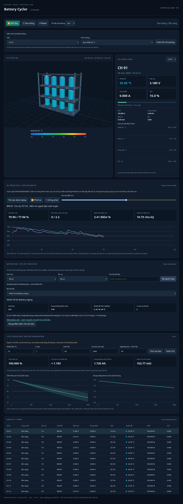

# Digital-Twin

Battery cycler simulator with a realtime 12-cell 3D dashboard.

Requires Python 3.11+; no external dependencies.

## BatteryLake metadata + trained ML on real discharge records

### Live per-channel ML RUL

The 12 simulated channels now feed their running voltage/current/temperature
into independent early-discharge windows. Each channel waits for a complete
600-second discharge window (at least 10 samples), computes the same
seven features as the NASA training pipeline, and performs server-side
Random Forest inference once per discharge cycle. The latest result,
feature cycle, sample count and simulated update timestamp are included
in `/api/state` under each channel's `live_ml` field and shown in the
channel table and selected-cell charts. The SOH chart plots simulated SOH
against ML SOH, with an 80% EOL reference; the second chart plots predicted
remaining cycles. Each point is one completed feature window, not a
fabricated intermediate prediction. Up to 200 per-channel points are held
in the server under `live_ml_history`, so browser refresh does not lose the
server's window. Pause freezes collection; Reset clears all predictions.

**These live results are experimental:** NASA-trained trees have not been
calibrated or validated on the synthetic rack signals. The NASA hold-out
metrics do not describe accuracy on these channels. They are not the
physics scenario forecast and must not be interpreted as verified battery
life. The replay remains a separate validated NASA backtest. Live RUL
means additional cycles to 80% SOH, not remaining steps in the three-cycle
demo. Predictions may fluctuate; they are not forced to decrease.

No physical cycler adapter is connected. Real channel updates require the
instrument's protocol/API or CSV stream and a model validated for its cells
and test conditions. Never feed charge/rest samples into this discharge
model. Features exclude current-cycle capacity and future data; invalid or
out-of-order timestamps are rejected. Short discharges show insufficient
data instead of inventing a prediction. The independent safety checks run
before feature collection; a STOP freezes predictions and current.

See [executed live-channel results](results/LIVE-ML-REPORT.md).

The new **BatteryLake** panel calls the public metadata JSON interface from
`tianwen1209/batterylake`, pinned at commit
`8d2a7304e4841b815287d3d0b2fcc67fea95b200`. You can search/filter its
40 datasets, inspect a record, and copy a temperature setpoint and the
maximum discharge C-rate into the illustrative scenario forecast.
Metadata does not itself contain capacity trajectories or calibrate a model.
Use the original links for data access, licensing and citation. The catalog
requires Internet access to `raw.githubusercontent.com`; errors are reported
without replacing the catalog with synthetic records.

Local read-only APIs:

```text
GET /api/batterylake/datasets?chemistry=LCO&task=SOH&search=NASA
GET /api/batterylake/datasets/dataset_01
GET /api/ml/replay
POST /api/ml/predict
```

BatteryLake's website API console contains simulated `/v1` calls. This
integration uses their actual public metadata files rather than claiming
an authenticated REST model service is connected.

The **ML Prediction / Raw Data Replay** panel uses Random Forest models
trained on NASA discharge time-series CSV records (a public export linked
to the NASA dataset represented by BatteryLake `dataset_01`). No simulated
cycler data is used to train these models. B0005/B0006/B0007 are training
cells; B0018 is a separate test cell. Predictions use cycle number and
voltage/current/temperature from the first 600 discharge seconds. Capacity
from the current full discharge is excluded from the features.

Load the replay, press Play, or move its cycle slider. The browser calls
`POST /api/ml/predict` for actual model inference. SOH compares measured
capacity / first observed capacity against predicted SOH; RUL compares
remaining cycles to the first observed 80% crossing against prediction.
Ground truth RUL is retrospective and is never a model input. RUL metrics
exclude post-EOL rows; the replay retains them and may show nonzero model
RUL after the measured crossing. Do not apply these four-cell NASA models
to arbitrary chemistries or the illustrative 12-cell rack.

See [ML metrics, data provenance and screenshot](results/ML-REPORT.md).
The server reads our own exported JSON forests, without pickle/joblib or
runtime ML packages. **Optional retraining** needs:

```sh
python -m pip install -r requirements-ml.txt
python -B train_ml.py
python -B -m unittest -v test_aging test_integrations
```

Training downloads the pinned 21 MB measured CSV export, verifies SHA-256,
extracts 636 cycles from 169,766 samples, and overwrites our model/report
artifacts. The raw download is ignored under `data/`. No third-party model
file is loaded. `POST /api/ml/predict` accepts a JSON `features` object with
exactly `cycle`, `voltage_mean`, `voltage_std`, `voltage_end`,
`temperature_mean`, `current_mean` and `ambient_temperature` (V, A, °C).

Reports and JSON artifacts explicitly use UTF-8 on Windows as well as
Linux. The pinned retraining dependencies require Python 3.11 or later;
the Python 3.8 runtime is not supported by that requirements file.

## Abnormal-cell cases and STOP alarms

Choose a cell and inject overheat (50 °C), overvoltage (4.5 V), overcurrent
(8 A), or sudden capacity loss. Click Start if paused; injection takes
effect at the next simulation step. A violation immediately latches
**STOP**, pauses the entire rack, sets all channel currents to zero, and
records the offending values and reason. Start is rejected with HTTP 409
until Reset clears the fault and creates fresh cells.

The same limits apply to uninjected telemetry: 45 °C, voltage outside
3.0–4.2 V (1e-5 V discretization tolerance), |current| above 2.2 A, or SOH
below 80%. These limits match the demonstration protocol, not a universal
battery safety standard. The simulation source freezes on STOP; it is not
an independent hardware interlock and does not command a physical cycler.

See [executed abnormal-case report](results/SAFETY-REPORT.md).

## SOH, cycle prediction and battery degradation

The dashboard now tracks SOH, usable capacity, internal resistance and
equivalent full cycles (EFC) for every cell. Aging feeds back into subsequent
voltage, thermal and charge/discharge calculations. EFC is total charge plus
discharge throughput divided by twice the nominal capacity; it is different
from the protocol's numbered cycles. Reset creates fresh, unaged cells.

Select a cell and use **Cycle Prediction / Battery Degradation** to compare
temperature, C-rate, DoD, forecast horizon and EOL threshold. The forecast
starts from that cell's current simulated SOH/EFC, refreshes every five
seconds, and estimates additional operational cycles to EOL. Its scenario
does not change the realtime cycling protocol. CSV exports include scenario
metadata, SOH, capacity, resistance and sensitivity curves. Scenario edits
disable export until a new valid forecast is computed.

The model uses `SOH = exp(-damage)`, with damage per EFC equal to
`0.00025 * 2^((temperature-25)/10) * sqrt(max(C-rate,0.1)) * DoD^0.3`.
Live aging uses DoD=1 as its throughput-based approximation. Future
operational cycles add DoD EFC each. Capacity is nominal capacity times SOH;
resistance is initial resistance times `1 + 1.5*(1-SOH)`. These coefficients
are demonstration assumptions, not chemistry-specific fits or AI outputs.
The ±30% bands vary the aging rate; they are not confidence intervals.

[BatteryTwin Studio](https://batterytwin.ai/#studio) was requested as a
reference. This project does not use BatteryTwin code, data or API: its
website could not be read from this environment, and no API documentation
or credentials were supplied. A real integration still needs documented
endpoints, request/response formats and authentication. No API key belongs
in the browser or repository.

See [executed results and screenshots](results/REPORT.md). Reproduce the
12-cell, three-cycle report and baseline/warm/fast forecasts with:

```sh
python -B -m unittest -v test_aging
python -B report.py --output results
```

JSON predictions are served at `/api/prediction?cell=1&temperature_c=25&c_rate=1&dod=0.8&horizon=2000&eol_soh=0.8`.
Cell IDs are 1–12, temperature −10 to 60 °C, C-rate 0.1–5, DoD 0.05–1,
horizon 10–10,000 integer cycles and EOL SOH 0.5–0.95. Invalid, duplicate,
nonfinite or unknown parameters return HTTP 400.

## Dashboard screenshots and simulation results



[ML test results](results/ML-REPORT.md) · [Abnormal cell STOP cases](results/SAFETY-REPORT.md)

All 12 cells completed three cycles in the recorded example run. The highest
temperature was 28.72 °C, and the last cell finished after approximately
8.06 simulated hours. These are illustrative model outputs, not hardware
measurements. See the [completed dashboard](results/dashboard-aging-completed.png)
and [latest executed report](results/REPORT.md). The earlier `results.json`
and `dashboard-running.png` files retain the original run before aging was added.

## Realtime 3D dashboard

```sh
python -B server.py --port 8000
```

Open the dashboard on port 8000 in a browser on the same machine. The server
binds to loopback by default. The cloud onboarding interface does not provide
a browser preview; local requests can still validate the server.

The dashboard displays a 12-channel rack using WebGL 2 and bundled Three.js
0.180.0 (MIT license in `web/vendor/THREE-LICENSE.txt`). No CDN, npm install,
or runtime Internet connection is needed. Drag to rotate, scroll to zoom,
and select a cell in 3D, the dropdown, or the channel table.

Start/pause/reset control the shared simulation. Speed options 1×, 10×, 60×,
and 300× mean simulated seconds per wall-clock second. Telemetry is polled
every 250 ms and charts retain up to 240 samples per cell. Reset clears
history. Charts show temperature, voltage, current and SOC versus simulated
time, with independent automatically scaled vertical ranges.

All cells perform three cycles at 2 A, with slightly different capacities,
resistances, initial SOCs and ambient temperatures. The fixed temperature
color scale is 20–45 °C and is clamped outside that range. Colors indicate
one uniform modeled temperature per cell, not a spatial temperature field.
Each cell stops independently on completion or a thermal fault. The server
uses the Python model in `main.py`; its simulation progresses even if the
browser is closed. Pause freezes simulation time. The server is a local
development tool with shared state, without user authentication.

## Run on Replit

1. Create a Python app in Replit and upload/extract the supplied
   `cycler-replit.zip` into the project root. Ensure `server.py`, `main.py`,
   `.replit`, and the complete `web/` directory are at the root, not inside
   an extra enclosing folder. Preserve other files if importing into an
   existing project. Alternatively import the GitHub repository after
   these files are available on the repository's `main` branch.
2. The supplied `.replit` uses Python 3.11 and sets the Run command to
   `python -B server.py --host 0.0.0.0 --port 8000`.
   If configuring an existing app manually, use this command and expose
   internal port 8000 as external port 80 in its port configuration.
3. Click Run and open the app's Preview/Webview. Click **Bắt đầu** to start
   simulation. Replit's preview forwards browser requests to the Python
   server; no additional packages or API keys are required.
4. If your runtime supplies a different `PORT`, use
   `python -B server.py --host 0.0.0.0` to read it automatically and configure
   port forwarding accordingly. An explicit `--port` takes priority.

The app accepts same-host HTTP and HTTPS browser origins so controls work
behind the HTTPS preview proxy. Keep your demo's access limited to intended
viewers: simulation controls are shared across all visitors. Run/Preview is
for development; public publishing and hosting costs are separate Replit
actions. Browser WebGL 2 support is required for 3D. Reset or restarting
the server clears the simulation, and no telemetry is saved persistently.

## CSV simulation

```sh
python main.py --cycles 2 --capacity-ah 2.5 --current-a 1 --output /tmp/cycler.csv
```

Each cycle charges at constant current, tapers at 4.2 V, rests, discharges
at constant current to 3.0 V, and rests again. Positive current charges;
negative current discharges. CSV measurements describe the end of each step.
Charge ends when the CV current falls to 5% of the requested current.
SOC initially equals 20%; subsequent cycles start at the previous final SOC.
The first cycle therefore has a different charge capacity from later cycles.

Use `python main.py --help` for configurable capacity, current, timestep,
rest duration and initial SOC. Output paths must have an existing parent
directory. An existing output file is overwritten. On a thermal limit or
timeout the program exits with a nonzero status and retains partial CSV data.

This is an illustrative digital twin: linear open-circuit voltage, a simple
cycle-aging model and a lumped thermal model. It does not model calendar
aging, cell imbalance, charging efficiency or hardware communication. It must not
be used to control or validate real battery equipment without calibrated
models and independent hardware safety controls.
