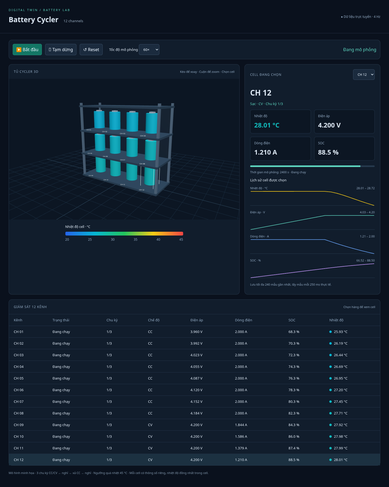

# Digital-Twin

Battery cycler simulator with a realtime 12-cell 3D dashboard.

Requires Python 3.10+; no external dependencies.

## Dashboard screenshots and simulation results



All 12 cells completed three cycles in the recorded example run. The highest
temperature was 28.72 °C, and the last cell finished after approximately
8.06 simulated hours. These are illustrative model outputs, not hardware
measurements. See the [completed dashboard](results/dashboard-completed.png)
and [JSON results](results/results.json).

## Realtime 3D dashboard

```sh
python -B server.py --port 8000
```

Open the dashboard on port 8000 in a browser on the same machine. The server
binds to loopback by default. The cloud onboarding interface does not provide
a browser preview; local requests can still validate the server.

The dashboard displays a 12-channel rack using WebGL 2 and bundled Three.js
0.180.0 (MIT license in `web/vendor/THREE-LICENSE.txt`). No CDN, npm install,
or runtime Internet connection is needed. Drag to rotate, scroll to zoom,
and select a cell in 3D, the dropdown, or the channel table.

Start/pause/reset control the shared simulation. Speed options 1×, 10×, 60×,
and 300× mean simulated seconds per wall-clock second. Telemetry is polled
every 250 ms and charts retain up to 240 samples per cell. Reset clears
history. Charts show temperature, voltage, current and SOC versus simulated
time, with independent automatically scaled vertical ranges.

All cells perform three cycles at 2 A, with slightly different capacities,
resistances, initial SOCs and ambient temperatures. The fixed temperature
color scale is 20–45 °C and is clamped outside that range. Colors indicate
one uniform modeled temperature per cell, not a spatial temperature field.
Each cell stops independently on completion or a thermal fault. The server
uses the Python model in `main.py`; its simulation progresses even if the
browser is closed. Pause freezes simulation time. The server is a local
development tool with shared state, without user authentication.

## Run on Replit

1. Create a Python app in Replit and upload/extract the supplied
   `cycler-replit.zip` into the project root. Ensure `server.py`, `main.py`,
   `.replit`, and the complete `web/` directory are at the root, not inside
   an extra enclosing folder. Preserve other files if importing into an
   existing project. Alternatively import the GitHub repository after
   these files are available on the repository's `main` branch.
2. The supplied `.replit` uses Python 3.11 and sets the Run command to
   `python -B server.py --host 0.0.0.0 --port 8000`.
   If configuring an existing app manually, use this command and expose
   internal port 8000 as external port 80 in its port configuration.
3. Click Run and open the app's Preview/Webview. Click **Bắt đầu** to start
   simulation. Replit's preview forwards browser requests to the Python
   server; no additional packages or API keys are required.
4. If your runtime supplies a different `PORT`, use
   `python -B server.py --host 0.0.0.0` to read it automatically and configure
   port forwarding accordingly. An explicit `--port` takes priority.

The app accepts same-host HTTP and HTTPS browser origins so controls work
behind the HTTPS preview proxy. Keep your demo's access limited to intended
viewers: simulation controls are shared across all visitors. Run/Preview is
for development; public publishing and hosting costs are separate Replit
actions. Browser WebGL 2 support is required for 3D. Reset or restarting
the server clears the simulation, and no telemetry is saved persistently.

## CSV simulation

```sh
python main.py --cycles 2 --capacity-ah 2.5 --current-a 1 --output /tmp/cycler.csv
```

Each cycle charges at constant current, tapers at 4.2 V, rests, discharges
at constant current to 3.0 V, and rests again. Positive current charges;
negative current discharges. CSV measurements describe the end of each step.
Charge ends when the CV current falls to 5% of the requested current.
SOC initially equals 20%; subsequent cycles start at the previous final SOC.
The first cycle therefore has a different charge capacity from later cycles.

Use `python main.py --help` for configurable capacity, current, timestep,
rest duration and initial SOC. Output paths must have an existing parent
directory. An existing output file is overwritten. On a thermal limit or
timeout the program exits with a nonzero status and retains partial CSV data.

This is an illustrative digital twin: linear open-circuit voltage, fixed
internal resistance and a lumped thermal model. It does not model aging,
cell imbalance, charging efficiency or hardware communication. It must not
be used to control or validate real battery equipment without calibrated
models and independent hardware safety controls.
