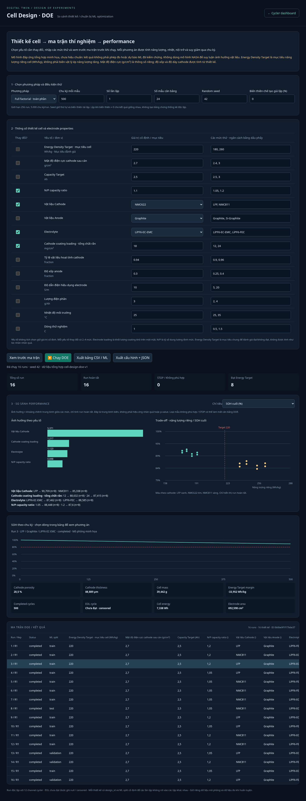

# DOE · executed cell-design comparison

Source: synthetic_doe, model cell-design-doe-v1, not calibrated. Material assumptions are embedded in the JSON. These are not measurements or validated ML predictions.

## Executed design

Full factorial: N/P {1.05, 1.2} × Cathode {LFP, NMC811} × Electrolyte {LiPF6-EC-EMC, LiPF6-FEC} × Loading {12, 24} mg/cm². Fixed Capacity Target 2.5 Ah, Energy Density Target 220 Wh/kg, cathode bulk density 2.7 g/cm³, graphite anode, ambient 25 °C and 1C. Seed 42, one replicate, zero manufacturing variation.

- 16 runs × 500 cycles: all completed.
- 8/16 designs met the initial 220 Wh/kg target.
- Initial specific energy: 175.99–261.71 Wh/kg.
- Final SOH: 83.59–92.14%.

## Descriptive effects · initial specific energy

| Factor | Marginal mean range (Wh/kg) |
|---|---:|
| cathode | 64.677 |
| cathode_loading_mg_cm2 | 14.527 |
| np_ratio | 6.393 |
| electrolyte | 0.000 |

Rankings follow the assumed response model and chosen ranges, not experimental evidence. Electrolyte has zero initial-energy effect in this simplified parameterization but changes modeled resistance/aging.

## Validation

25 unit/integration tests passed, covering factorial balance, reproducibility, constraint failures, thermal STOP, censored EOL, objective independence, grouped replicate splits, known marginal effects and CLI CSV/JSON export. Chromium verified preview/run, metric and row selection, CSV/JSON downloads, infeasible runs, invalid inputs, origin rejection and mobile layout with no JS errors. Cycler state remained unchanged. CLI reproduction matched browser JSON exactly.

[Configuration and JSON results](doe-example.json) · [Tabular experiment CSV](doe-example.csv)

Reproduce: `python -B run_doe.py --config results/doe-example.json --output doe-output`.
