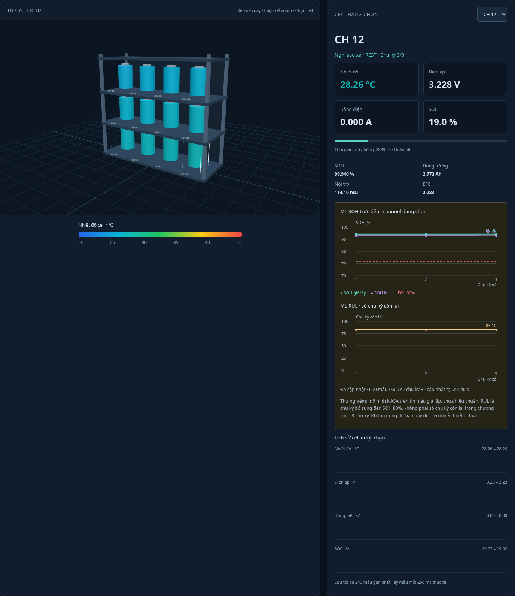
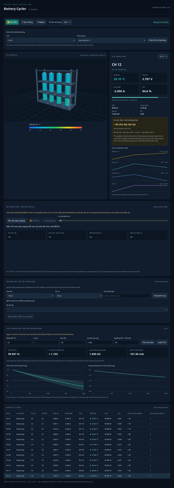

# Live-channel ML RUL demonstration

The selected-channel card now draws live SOH and RUL history instead of text-only metrics.

12 simulated channels produced 36 server-side ML updates across three discharge cycles. Predictions use each channel’s first 600 discharge seconds and refresh independently once per cycle. There is no physical cycler connection.

Model: NASA Random Forest. The transfer to simulated channels is experimental and not calibrated; NASA hold-out accuracy does not apply. These are not verified remaining lifetimes.

| Channel | Last feature cycle | Update time (s) | ML RUL (experimental cycles) |
|---|---:|---:|---:|
| CH 01 | 3 | 23714 | 79.4 |
| CH 02 | 3 | 23884 | 79.4 |
| CH 03 | 3 | 24055 | 79.4 |
| CH 04 | 3 | 24225 | 79.5 |
| CH 05 | 3 | 24394 | 80.0 |
| CH 06 | 3 | 24561 | 82.8 |
| CH 07 | 3 | 24726 | 83.1 |
| CH 08 | 3 | 24892 | 83.1 |
| CH 09 | 3 | 25056 | 83.1 |
| CH 10 | 3 | 25219 | 83.1 |
| CH 11 | 3 | 25381 | 83.1 |
| CH 12 | 3 | 25540 | 83.1 |

Verified: correct per-channel feature ownership; model output matches direct inference; no current-cycle capacity in features; no update before full window; reset clears windows/results; safety blocks bad samples; mobile layout; no browser JS errors.

[36 update records CSV](live-channel-predictions.csv) · [Snapshots and features JSON](live-channel-predictions.json)
