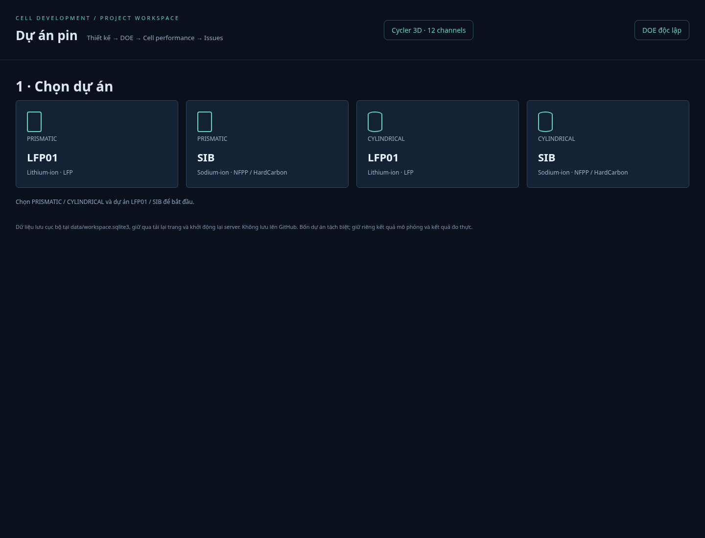
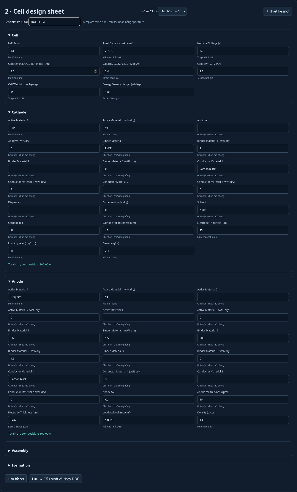
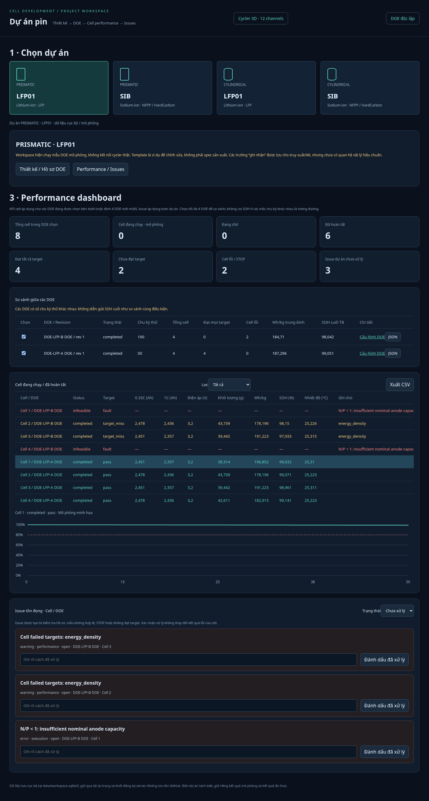

# Project / DOE / cell performance workspace

Source: synthetic DOE examples in a temporary SQLite database. Not measured cell data. The example database is not shipped or installed into a user workspace.

## Select a project

Supported: PRISMATIC LFP01, PRISMATIC SIB, CYLINDRICAL LFP01 and CYLINDRICAL SIB. SIB uses illustrative NFPP / HardCarbon profiles, not an LFP model in disguise. Form-factor-specific physics is not calibrated.

## Cell design sheet

60 input fields plus computed dry-composition totals cover Cell, Cathode, Anode, Assembly and Formation. Field roles distinguish modeled inputs, targets, validation and recorded-only information.

## Performance / comparison / unresolved issues

Two LFP experiments were executed from two saved design revisions/templates: DOE-LFP-A (50 cycles; valid N/P), DOE-LFP-B (100 cycles; one invalid N/P level and a higher energy target). Different horizons are flagged in the comparison.

| Quantity | Observed |
|---|---:|
| Selected DOE samples | 8 |
| Running at completed snapshot | 0 |
| Completed successfully | 6 |
| Passed every configured target | 4 |
| Completed but missed targets | 2 |
| Infeasible / fault samples | 2 |
| Unresolved issues after resolving one | 3 |

One issue was resolved with a note. Cell failures and target outcomes were retained. The workspace was reloaded and counts/history/resolution persisted. A separate CYLINDRICAL SIB experiment completed four sodium-family samples without altering the LFP project or 12-channel demo.

## Validation

36 unit/integration tests cover project isolation, revision conflicts, SQLite persistence, recipe totals, effective BOM consistency, large prismatic capacity inputs, immutable experiment snapshots, lithium/sodium family checks, all-target assessment, actual running counts, two-worker admission, issue resolution and stale-job handling, plus existing DOE/ML/safety behavior. Chromium exercised project selection → 60-field editor → save → project-bound DOE → dashboard, two-experiment comparisons, cell fault filters, resolution, CSV with complete effective BOM, page reload, mobile sizing and sodium-specific material options with no JavaScript errors.

[Full example workspace snapshot](project-workspace-example.json) · [Eight cell rows and effective BOM CSV](project-cells-example.csv)

Templates, responses and material parameters are examples. No physical cycler data, formation automation or calibrated sodium degradation model is claimed.
