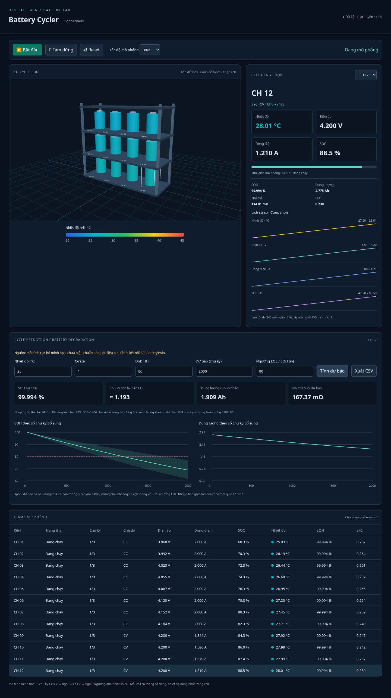

# Cycling and degradation results

Source: local illustrative model. Not calibrated; BatteryTwin API is not connected.

12 cells, three CC/CV charge/discharge cycles each at 2 A, with 60-second rests.
Forecasts assume 80% DoD, a constant operating temperature/C-rate, and 80% SOH EOL.

| Cell | Final SOH (%) | EFC | Peak temperature (°C) | Baseline RUL (cycles) | Warm 35 °C RUL | Fast 2C RUL |
|---|---:|---:|---:|---:|---:|---:|
| CH 01 | 99.9390 | 2.615 | 25.93 | 1190 | 595 | 841 |
| CH 02 | 99.9391 | 2.585 | 26.19 | 1190 | 595 | 841 |
| CH 03 | 99.9391 | 2.555 | 26.44 | 1190 | 595 | 841 |
| CH 04 | 99.9392 | 2.524 | 26.69 | 1190 | 595 | 841 |
| CH 05 | 99.9392 | 2.494 | 26.95 | 1190 | 595 | 841 |
| CH 06 | 99.9393 | 2.464 | 27.20 | 1190 | 595 | 841 |
| CH 07 | 99.9394 | 2.434 | 27.45 | 1190 | 595 | 841 |
| CH 08 | 99.9395 | 2.404 | 27.71 | 1190 | 595 | 841 |
| CH 09 | 99.9396 | 2.374 | 27.96 | 1190 | 595 | 841 |
| CH 10 | 99.9397 | 2.343 | 28.21 | 1190 | 595 | 841 |
| CH 11 | 99.9399 | 2.313 | 28.47 | 1190 | 595 | 841 |
| CH 12 | 99.9400 | 2.283 | 28.72 | 1190 | 595 | 841 |

RUL is additional operational cycles from the post-run health state. Each forecast
cycle is 0.8 EFC. Sensitivity curves use ±30% aging rate and are not statistical
confidence intervals. No calendar aging, chemistry-specific effects or trained AI model.

Reproduce: `python -B report.py --output results`.

Validation completed: five model unit tests; Chromium WebGL rendering;
live SOH and selected-cell forecasts; warm scenario; browser CSV download;
five invalid API requests; pause/reset; all 12 cells completing three cycles;
dashboard health matching this report; mobile layout; no JavaScript errors.

[Cycle CSV](cycle-summary.csv) · [Forecast CSV](degradation-predictions.csv) · [JSON](aging-results.json)

[Completed dashboard](dashboard-aging-completed.png)
