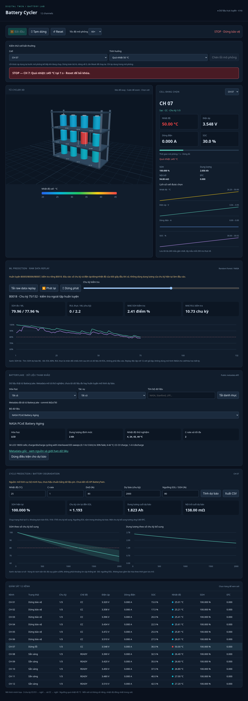

# Abnormal-cell STOP validation

All four cases were executed in the browser on CH 07: overheat, overvoltage, overcurrent and sudden capacity loss. Each latched STOP, froze simulation, set all currents to zero and rejected restart with HTTP 409 until Reset. Normal three-cycle runs and an uninjected overtemperature were tested separately.

[Alarm records including observed offending values](safety-cases.json)

Simulation-only safeguards; not physical cycler control or hardware protection.
